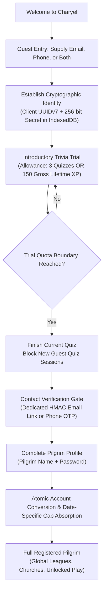
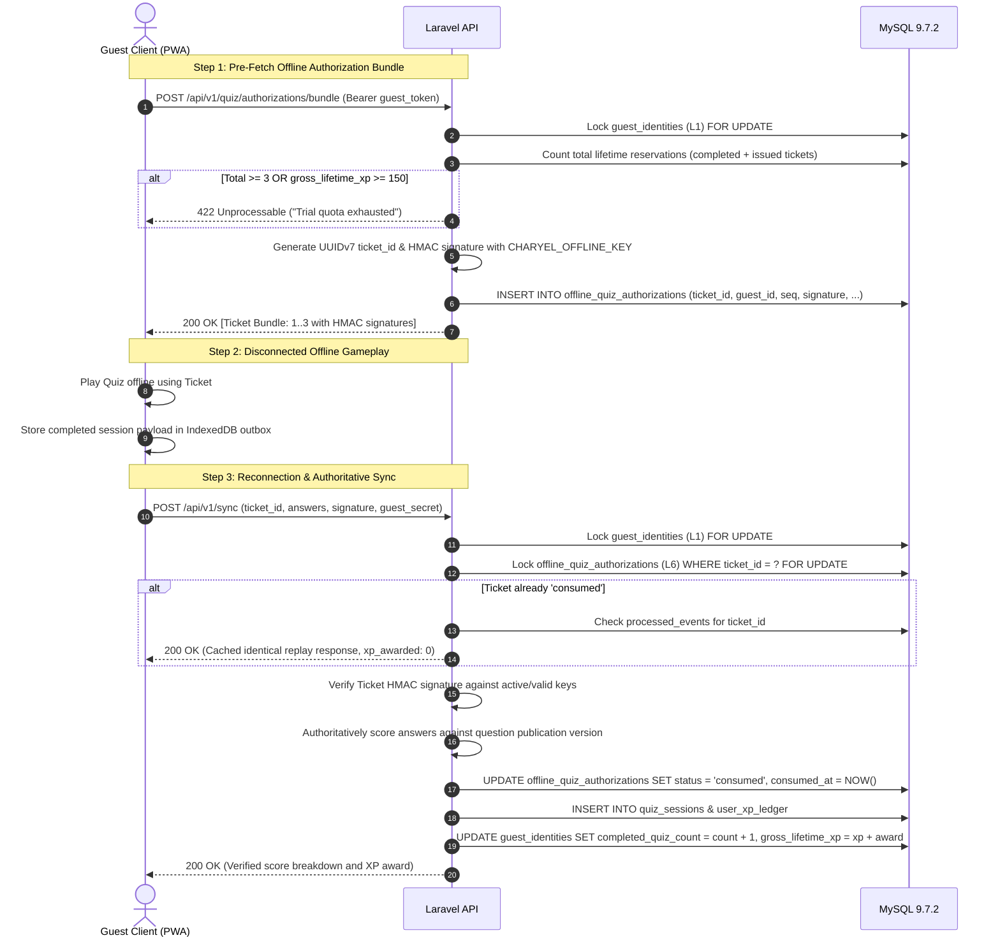
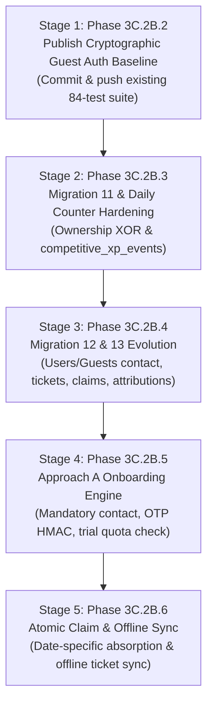

# Charyel — Guest Onboarding, Trial Gameplay & Contact Verification Architecture

**Document ID:** `CHARYEL-ARCH-PHASE-3C2B-ONBOARDING-REV3.1`
**Author:** Antigravity Engineering
**Date:** October 17, 2026
**Revision:** 3.1.0-FINAL-CORRECTED
**Status:** Approved Architectural Specification (Design & Documentation Only — Zero Code or Migration Changes)
**Milestone:** Phase 3C.2B Architecture Final Targeted Reconciliation
**Target Platform:** Laravel 13 API (PHP 8.3+), Oracle MySQL 9.7.2 LTS, React 19 PWA (IndexedDB / Web Crypto)

---

## 1. Document Identity & Targeted Reconciliation Ledger

This document is the authoritative **Revision 3.1.0-FINAL-CORRECTED** specification for Charyel's guest onboarding, introductory trial gameplay, contact verification, competitive XP carryover, transaction concurrency, and cryptographic key management.

### 1.1 Document Synchronization Status
* **Brain Artifact:** `C:\Users\MAYANA\.gemini\antigravity\brain\1d9e0d79-3a5b-4c19-b15d-a7504af9fc02\charyel-guest-onboarding-and-trial-policy-design.md` (Synchronized to Revision 3.1.0)
* **Workspace Repository:** `c:\laragon\www\charyel\docs\architecture\charyel-guest-onboarding-and-trial-policy-design.md` (Synchronized to Revision 3.1.0)
* **Preceding Documents Replaced:** All previous drafts (Revision 2.0.0 and Revision 3.0.0) are completely superseded.

### 1.2 Reconciliation Table of Targeted Corrections

| Item | Finding in Revision 3.0.0 | Revision 3.1.0 Targeted Reconciled Solution | Architecture Section |
| :--- | :--- | :--- | :--- |
| **A. Date-Specific Claim Attribution** | `guest_identity_claims` held only aggregate absorbed values, failing multi-day guest history, cross-midnight play, and late sync. | Added `guest_claim_daily_attributions` table with `UNIQUE(guest_identity_id, activity_date)`. Date-specific capacity absorption integrated directly into `CompetitiveXpAccountingService`. | Section 3 |
| **B. Competitive Accounting Integration** | Claim absorption updated counters outside `CompetitiveXpAccountingService`, risking divergent capacity calculations. | Unified source of truth: `CompetitiveXpAccountingService::absorbGuestDailyCompetitiveXp()` handles row locking, cap headroom, audit events, and daily totals identically to live quiz submissions. | Section 3 |
| **C. Offline Lifetime Trial Reservations** | Allowed potential quota recycling if tickets expired or were canceled. Sync replays risked duplicate errors. | Permanent reservation invariant: every issued ticket permanently consumes a trial slot (1..3). Idempotent replay returns cached 200 OK without re-awarding XP or throwing 409 errors. | Section 5 |
| **D. InnoDB Deadlock Realities** | Overstated deadlock elimination as "mathematically impossible", ignoring foreign key S-locks and index gap contention. | Formalized application-level lock hierarchy as deadlock minimization, paired with InnoDB index precision, pre-flight checks, and mandatory bounded retries (`DB::transaction(fn(), 3)` with jitter). | Section 4 |
| **E. Production Fail-Closed Cryptography** | Silent HKDF fallback from `APP_KEY` could mask missing production keys. Raw key encoding was unspecified. | Production fail-closed invariant (`APP_ENV=production` throws on missing keys). Base64 32-byte raw decoding. 7-day key retention matching offline ticket TTL. Domain-separated binding on OTPs. | Section 6 |
| **F. Migration Design & Table Naming** | Renamed `competitive_xp_events` to `competitive_xp_audit_logs`. Contact `CHECK` on `guest_identities` would break existing contactless guests. | Reconciled name to `competitive_xp_events`. Added `is_legacy` flag to `guest_identities` so constraint applies only to new guests (`CHECK (is_legacy = 1 OR email IS NOT NULL OR phone_number IS NOT NULL)`). | Section 8 |
| **G. Repository & Working Tree Truth** | Described tree as "clean base" despite 5 modified and 4 untracked files. | Completely corrected: details commit `1888a4d`, uncommitted Phase 3C.2B.2 guest-auth files, and architecture doc status. | Section 9 |

---

## 2. Approved Approach A Lifecycle & State Machine

Charyel has officially approved **Approach A: Mandatory Contact Information Before Guest Gameplay**.



### 2.1 Core Invariants
1. **Mandatory Contact Capture Upfront:** Every guest must supply at least an email address or an E.164 phone number before their first quiz session or offline bundle can be authorized. Both may be supplied.
2. **Contact State is Unverified Initially:** Contact details remain unverified during trial gameplay. Verification is strictly mandatory before permanent registration or claiming.
3. **Cryptographic Proof-of-Possession:** Contact details do not confer identity ownership. An attacker knowing a guest's email or phone cannot access, inspect, or claim that guest's progress without possessing the client's **256-bit secret**.
4. **Trial Quota Boundary:** A guest identity may complete up to **3 quizzes OR 150 validated gross lifetime XP**, whichever occurs first. A legitimately started quiz may finish even if its award exceeds 150 XP. New quiz sessions are then hard-blocked server-side.
5. **Combined Competitive XP Cap Invariant:** Conversion or progress claiming must never grant a player a fresh daily competitive allowance. The combined competitive XP attributed to the person across their guest and registered identities **must never exceed 400 XP for the same UTC date**.

---

## 3. Competitive XP Carryover & Accounting Architecture

### 3.1 Taxonomy of XP Variables
For any calendar date $D$ on which guest $G$ is claimed by registered user $U$:

```
┌────────────────────────────────────────────────────────────────────────────────────────┐
│                                    XP TAXONOMY                                         │
├────────────────────────────────┬───────────────────────────────────────────────────────┤
│ 1. Historical Guest XP         │ G_comp(D): Competitive XP earned by guest on date D.  │
│    (Immutable Provenance)      │ Recorded in user_daily_competitive_counters under     │
│                                │ principal_key = 'G:<guest_id>'. Never deleted.        │
├────────────────────────────────┼───────────────────────────────────────────────────────┤
│ 2. Registered Prior XP         │ U_prior(D): Competitive XP already earned by user U   │
│    (Prior User Gameplay)       │ on date D under principal_key = 'U:<user_id>'.        │
├────────────────────────────────┼───────────────────────────────────────────────────────┤
│ 3. Absorbed Daily Allowance    │ ΔU_absorbed(D): Capacity of user U's 400-XP allowance │
│    (Capacity Consumption)      │ consumed by the claimed guest on date D:              │
│                                │   ΔU_absorbed(D) = min(G_comp(D), 400 - U_prior(D))   │
├────────────────────────────────┼───────────────────────────────────────────────────────┤
│ 4. Newly Eligible Award        │ ΔU_award(D): Additional competitive XP credited to    │
│    (Leaderboard Increment)     │ user U's active league total. Equal to ΔU_absorbed(D) │
│                                │ IF date D is within the current active league period. │
├────────────────────────────────┼───────────────────────────────────────────────────────┤
│ 5. Lifetime Progression XP     │ G_lifetime: 100% of all gross XP earned by guest G.   │
│    (Uncapped Total XP)         │ Fully credited to user_profiles.total_xp via a single │
│                                │ 'guest_claim_transfer' ledger row. Uncapped.          │
└────────────────────────────────┴───────────────────────────────────────────────────────┘
```

### 3.2 Date-Specific Claim Attribution Schema
A guest may accumulate trial gameplay across multiple UTC dates prior to claiming. To guarantee exactly-once accounting, auditability, and late-sync reconciliation, the system introduces two distinct tables in Migration 13:

1. **`guest_identity_claims` (Parent Envelope):**
   Tracks the overall claim relationship between the user and guest identity.
2. **`guest_claim_daily_attributions` (Date-Specific Audit Breakdown):**
   Records the exact accounting calculation for each distinct activity date $D$:
   ```sql
   CREATE TABLE guest_claim_daily_attributions (
       id BIGINT UNSIGNED AUTO_INCREMENT PRIMARY KEY,
       claim_id BIGINT UNSIGNED NOT NULL,
       guest_identity_id BIGINT UNSIGNED NOT NULL,
       user_id BIGINT UNSIGNED NOT NULL,
       activity_date DATE NOT NULL,
       guest_competitive_xp SMALLINT UNSIGNED NOT NULL,
       user_prior_competitive_xp SMALLINT UNSIGNED NOT NULL,
       absorbed_competitive_xp SMALLINT UNSIGNED NOT NULL,
       unabsorbed_competitive_xp SMALLINT UNSIGNED NOT NULL,
       is_league_eligible BOOLEAN NOT NULL DEFAULT FALSE,
       event_id CHAR(36) NOT NULL UNIQUE,
       created_at TIMESTAMP DEFAULT CURRENT_TIMESTAMP,
       FOREIGN KEY (claim_id) REFERENCES guest_identity_claims(id) ON DELETE CASCADE,
       FOREIGN KEY (guest_identity_id) REFERENCES guest_identities(id) ON DELETE RESTRICT,
       FOREIGN KEY (user_id) REFERENCES users(id) ON DELETE CASCADE,
       UNIQUE KEY uq_guest_activity_date (guest_identity_id, activity_date),
       INDEX idx_user_activity_date (user_id, activity_date)
   ) ENGINE=InnoDB DEFAULT CHARSET=utf8mb4 COLLATE=utf8mb4_unicode_ci;
   ```

### 3.3 Integration with `CompetitiveXpAccountingService`
To prevent divergence between claim absorption and live quiz scoring, all competitive adjustments route through `CompetitiveXpAccountingService::absorbGuestDailyCompetitiveXp()`:

```php
public function absorbGuestDailyCompetitiveXp(
    int $userId,
    int $guestIdentityId,
    string $activityDate,
    int $guestCompetitiveXp,
    string $claimEventId,
    bool $isLeagueEligible,
    CarbonInterface $utcNow
): array {
    $userPrincipal = 'U:' . $userId;

    return DB::transaction(function () use (
        $userId,
        $guestIdentityId,
        $userPrincipal,
        $activityDate,
        $guestCompetitiveXp,
        $claimEventId,
        $isLeagueEligible,
        $utcNow
    ) {
        // 1. Acquire exclusive pessimistic row lock on the user's daily counter for the activity date
        $counter = $this->getOrCreateDailyCounterLocked($userPrincipal, $userId, null, $activityDate, $utcNow);

        $priorCompetitiveTotal = (int) $counter->competitive_xp_total;
        $headroom = max(0, self::DAILY_COMPETITIVE_CAP - $priorCompetitiveTotal);
        $absorbedXp = min($guestCompetitiveXp, $headroom);
        $unabsorbedXp = max(0, $guestCompetitiveXp - $absorbedXp);
        $newCompetitiveTotal = $priorCompetitiveTotal + $absorbedXp;

        // 2. Update user daily counter with newly absorbed competitive points
        DB::table('user_daily_competitive_counters')
            ->where('id', $counter->id)
            ->update([
                'competitive_xp_total' => $newCompetitiveTotal,
                'last_event_id' => $claimEventId,
                'updated_at' => $utcNow,
            ]);

        // 3. Append to typed audit log (competitive_xp_events)
        DB::table('competitive_xp_events')->insert([
            'principal_key' => $userPrincipal,
            'award_date' => $activityDate,
            'event_type' => 'guest_claim_absorption',
            'xp_delta' => $absorbedXp,
            'counter_before' => $priorCompetitiveTotal,
            'counter_after' => $newCompetitiveTotal,
            'reference_id' => 'claim:G:' . $guestIdentityId,
            'event_id' => $claimEventId,
            'created_at' => $utcNow,
        ]);

        return [
            'activity_date' => $activityDate,
            'guest_competitive_xp' => $guestCompetitiveXp,
            'user_prior_competitive_xp' => $priorCompetitiveTotal,
            'absorbed_competitive_xp' => $absorbedXp,
            'unabsorbed_competitive_xp' => $unabsorbedXp,
            'new_competitive_total' => $newCompetitiveTotal,
            'remaining_headroom' => self::DAILY_COMPETITIVE_CAP - $newCompetitiveTotal,
            'is_league_eligible' => $isLeagueEligible,
        ];
    }, 3);
}
```

### 3.4 Aggregates Exceeding 400 XP & League Period Policy
1. **Aggregates Exceeding 400 XP:**
   If $U_{\text{prior}}(D) + G_{\text{comp}}(D) > 400$, the excess points $G_{\text{excess}}(D) = G_{\text{comp}}(D) - \Delta U_{\text{absorbed}}(D)$:
   * **Progression Handled 100%:** The excess points remain fully credited to [`user_profiles.total_xp`](file:///c:/laragon/www/charyel/server/database/migrations/2026_10_16_000004_create_user_profiles_and_memberships.php#L20) as lifetime progression XP.
   * **Leaderboard Handled:** The user's registered counter caps at exactly 400 points. Zero excess points are awarded to the competitive leaderboard.
   * **Provenance Intact:** Historical guest counter records (`G:<id>`) remain unmodified in `user_daily_competitive_counters`.
2. **Weekly League Period Boundaries:**
   * A weekly league period runs from **Monday 00:00:00 UTC to Sunday 23:59:59 UTC**.
   * If activity date $D$ falls within the **current active league period**, $\Delta U_{\text{absorbed}}(D)$ is included in the registered user's active weekly leaderboard score.
   * If activity date $D$ falls within a **past, finalized league period**, past leaderboards are strictly immutable. $\Delta U_{\text{absorbed}}(D)$ updates the historical daily counter for date $D$, but `is_league_eligible = false` is recorded, and zero retroactive leaderboard modifications occur.
3. **Concurrent Scoring & Claims:**
   Because `absorbGuestDailyCompetitiveXp()` acquires the exact same exclusive row lock (`getOrCreateDailyCounterLocked`) on `user_daily_competitive_counters` as `awardCompetitiveXp()`, any quiz submission concurrent with a claim will serialize cleanly on InnoDB row locks. The second transaction will evaluate remaining headroom against the committed total of the first.

---

## 4. Transaction Locking, InnoDB Realities & Deadlock Resilience

### 4.1 Application-Level Lock Hierarchy
To minimize lock contention and prevent application-induced lock inversions, transactions acquire locks in the following canonical sequence:

$$\mathbf{L_1: guest\_identities} \;\longrightarrow\; \mathbf{L_2: users} \;\longrightarrow\; \mathbf{L_3: user\_profiles} \;\longrightarrow\; \mathbf{L_4: daily\_counters} \;\longrightarrow\; \mathbf{L_5: quiz\_sessions} \;\longrightarrow\; \mathbf{L_6: authorizations} \;\longrightarrow\; \mathbf{L_7: tokens}$$

Within any single table, multiple rows must always be locked in ascending primary key order (`ORDER BY id ASC`).

### 4.2 InnoDB Engine-Level Realities & Deadlock Resilience
While application-level lock hierarchy eliminates classic table-level inversions, **MySQL InnoDB can still experience transient deadlocks** under concurrent load due to:
1. **Foreign Key Shared Locks (S-locks):** Inserting a child row acquires an implicit shared lock on the referenced parent row.
2. **Next-Key / Gap Locks on Secondary Indexes:** Concurrent inserts into adjacent gaps of unique secondary indexes (e.g. `uq_principal_award_date` or `personal_access_tokens_token_unique`) can produce lock waits between competing transactions.
3. **Lock Escalation from Secondary to Clustered Index:** Resolving rows via a non-clustered index and upgrading to clustered record locks can cause mutual waits under high concurrency.

### 4.3 Mandatory Mitigation & Bounded Retry Architecture
1. **Precision Point Lookups:** All `lockForUpdate()` statements must query by unique primary keys or unique compound keys (`=`) to ensure InnoDB acquires point record locks rather than range gap locks.
2. **Pre-Flight Existence Checks:** Tables with unique constraints use non-locking pre-flight existence checks to prevent unnecessary gap lock acquisition.
3. **Mandatory Bounded Retries with Exponential Jitter:**
   All transactional service methods wrap execution in Laravel's `DB::transaction(fn(), 3)`. If MySQL returns Error 1213 (`Deadlock found when trying to get lock; try restarting transaction`), Laravel automatically re-executes the transaction up to 3 times with exponential backoff and random jitter (100ms..500ms).
4. **Idempotency Safeguard:** Because transactions may be retried after an engine deadlock, all database mutations inside the transaction closure must be completely idempotent.

---

## 5. Offline Quiz Authorization & Lifetime Reservation Protocol

### 5.1 Permanent Reservation Invariant
An offline guest client cannot check trial quota while disconnected. To guarantee that offline gameplay cannot exceed the 3-quiz trial limit:
1. The server **pre-authorizes** offline quiz sessions by issuing cryptographically signed tickets (`offline_quiz_authorizations`).
2. A guest may hold at most **3 lifetime quiz authorizations** (online + offline combined).
3. **No Quota Recycling:** Every issued ticket permanently consumes one trial reservation slot (sequence numbers 1, 2, or 3). If a ticket expires or is revoked, that slot is **NOT recycled** for additional trial play. Unconstrained play requires account registration.
4. **Permanent Unique Constraint:** The table enforces `UNIQUE KEY uq_guest_ticket_seq (guest_identity_id, sequence_number)`, physically restricting sequence numbers to 1, 2, or 3.



### 5.2 Idempotent Replay Handling
If a client experiences network disruption during sync and retries submitting an already-consumed ticket:
* The server inspects `offline_quiz_authorizations` and detects `status = 'consumed'`.
* It verifies the incoming payload against the recorded `payload_hash` in `processed_events`.
* **Identical Replay:** Returns `HTTP 200 OK` with the exact previously calculated score, `status: 'accepted'`, and `is_duplicate: true`. Zero additional XP is awarded. No error is thrown.
* **Conflicting Replay (Tampering):** If the payload hash differs, returns `HTTP 409 Conflict` (`IDEMPOTENCY_PAYLOAD_MISMATCH`).

### 5.3 Zero Trust for Client Timestamps & Scores
Client-reported timestamps, durations, and claimed scores are treated as unverified hints. The server authoritatively:
* Validates question IDs and selected option IDs against the immutable question publication snapshot.
* Calculates correct answers, base score, streak multiplier, and gross XP on the server.
* Derives the competitive award date from the **server's UTC receipt time**.

---

## 6. Dedicated Cryptographic Key Management & Production Fail-Closed

### 6.1 Production Fail-Closed Invariant
In production environments (`APP_ENV=production`), the application **must fail closed**:
* `CHARYEL_OFFLINE_KEY` and `CHARYEL_OTP_KEY` must be explicitly defined in environment configuration.
* If either key is missing, empty, or fails validation at boot time, the application throws `InvalidConfigurationException` and refuses to handle requests.
* **HKDF Fallback Restriction:** Deriving keys from `APP_KEY` via HKDF-Expand is **strictly restricted to local development and test environments** (`APP_ENV !== 'production'`).

```
┌──────────────────────────────────┬───────────────────────┬──────────────────────────────────────┐
│ Key Purpose                      │ Configuration Variable│ Production Requirement               │
├──────────────────────────────────┼───────────────────────┼──────────────────────────────────────┤
│ 1. Offline Ticket Signing        │ CHARYEL_OFFLINE_KEY   │ 256-bit base64 secret (Dedicated)    │
│ 2. Contact OTP / Token Hashing   │ CHARYEL_OTP_KEY       │ 256-bit base64 secret (Dedicated)    │
│ 3. Core Encryption (Sessions)    │ APP_KEY               │ 256-bit base64 secret (Laravel Core) │
└──────────────────────────────────┴───────────────────────┴──────────────────────────────────────┘
```

### 6.2 Raw Key Decoding & Length Validation
All cryptographic keys must resolve to exactly **32 raw bytes (256 bits)**:
```php
public static function decodeKey(string $secret): string
{
    if (str_starts_with($secret, 'base64:')) {
        $raw = base64_decode(substr($secret, 7), true);
    } elseif (ctype_xdigit($secret) && strlen($secret) === 64) {
        $raw = hex2bin($secret);
    } else {
        $raw = $secret;
    }

    if ($raw === false || strlen($raw) !== 32) {
        throw new RuntimeException("Invalid key format: secret must decode to exactly 32 raw bytes (256 bits).");
    }

    return $raw;
}
```

### 6.3 Key Identifiers (`kid`) & 7-Day Rotation Lifecycle
* Every issued ticket and OTP challenge records a `key_id` (e.g. `'v1'`, `'v2'`).
* **Active Signer:** New authorizations are signed using `config('auth.keys.active_kid')`.
* **Verifier Registry:** Verification resolves the matching key from the registry by `kid`.
* **Key Retention Period:** Because offline authorization tickets have a maximum validity of **7 days**, retired keys must be retained in the verification registry for **at least 7 days** after rotation.
* **Decommissioning:** After 7 days, the retired key is removed. Any un-synced ticket presenting a decommissioned key fails verification with `HTTP 401 Unauthorized` (`SIGNING_KEY_EXPIRED`).

### 6.4 Domain-Bound OTP Challenge Digest
For low-entropy 6-digit numeric OTPs ($10^6$ space), the HMAC-SHA256 digest binds all contextual parameters:

$$\text{TokenDigest} = \text{HMAC-SHA256}\Big(K_{\text{OTP}}, \; \text{"otp:v1:"} \parallel \text{challenge\_id} \parallel \text{":"} \parallel \text{contact\_type} \parallel \text{":"} \parallel \text{contact\_value} \parallel \text{":"} \parallel \text{purpose} \parallel \text{":"} \parallel \text{code}\Big)$$

* **Brute-Force Lockout:** Exactly 5 attempts allowed per challenge (`contact_verification_tokens.attempts`). Upon the 5th failure, `locked_at = NOW()` is set permanently.
* **TTL:** Strict 10-minute expiration.
* **Rate Limits:** 3 OTP requests per 10 minutes per IP and per normalized contact.

---

## 7. Phone-Only Registration & Conversion Compatibility

### 7.1 Schema Evolution for `users` Table (Migration 12)
```sql
ALTER TABLE users MODIFY email VARCHAR(255) NULL;
ALTER TABLE users ADD phone_number VARCHAR(32) NULL UNIQUE AFTER email;
ALTER TABLE users ADD phone_verified_at TIMESTAMP NULL AFTER email_verified_at;
ALTER TABLE users ADD CONSTRAINT chk_user_contact_present CHECK (email IS NOT NULL OR phone_number IS NOT NULL);
```

### 7.2 MySQL Nullable Unique Index Behavior
In MySQL InnoDB, multiple `NULL` values in a unique index do not collide (each `NULL` is treated as distinct). Therefore:
* Multiple users can have `email = NULL` (phone-only users).
* Multiple users can have `phone_number = NULL` (email-only users).
* Non-null emails and phone numbers remain strictly unique across the entire database.

### 7.3 Universal Login Contract
[`AuthController::login()`](file:///c:/laragon/www/charyel/server/app/Http/Controllers/Api/V1/AuthController.php) accepts `login_identifier` (accepting either an email address or an E.164 phone number) and `password`:
```php
$identifier = trim((string) $request->input('login_identifier'));
$user = filter_var($identifier, FILTER_VALIDATE_EMAIL)
    ? User::where('email', strtolower($identifier))->first()
    : User::where('phone_number', User::normalizePhone($identifier))->first();
```
All 65 existing registered-user tests provide valid unique emails and continue passing without modification.

---

## 8. Forward-Only Migration Sequencing & Schema Dependency Matrix

```
┌────────────────────────────────────────────────────────────────────────────────────────┐
│ FORWARD-ONLY MIGRATION SEQUENCE                                                        │
├───────────────────┬───────────────────────────────────────────┬────────────────────────┤
│ Slot              │ Migration File                            │ Scope                  │
├───────────────────┼───────────────────────────────────────────┼────────────────────────┤
│ Migration 10      │ 2026_10_16_000010_personal_access_tokens  │ Sanctum (Applied)      │
│ Migration 11      │ 2026_10_16_000011_harden_daily_counters   │ Ownership XOR & Audit  │
│ Migration 12      │ 2026_10_16_000012_evolve_users_and_guests │ Users/Guests Schema    │
│ Migration 13      │ 2026_10_16_000013_onboarding_and_tickets  │ Tokens, Tickets, Claims│
└───────────────────┴───────────────────────────────────────────┴────────────────────────┘
```

### 8.1 Migration 11: Counter Ownership & Typed Event Log
* **Target Table:** `user_daily_competitive_counters`
  ```sql
  ALTER TABLE user_daily_competitive_counters
  ADD CONSTRAINT chk_counter_ownership_xor
  CHECK ((user_id IS NOT NULL AND guest_identity_id IS NULL) OR (user_id IS NULL AND guest_identity_id IS NOT NULL));
  ```
* **New Table:** `competitive_xp_events` (Reconciled from previous `competitive_xp_audit_logs`)
  ```sql
  CREATE TABLE competitive_xp_events (
      id BIGINT UNSIGNED AUTO_INCREMENT PRIMARY KEY,
      principal_key VARCHAR(64) NOT NULL,
      award_date DATE NOT NULL,
      event_type ENUM('quiz_complete', 'guest_claim_absorption', 'late_sync_rollover', 'reversal') NOT NULL,
      xp_delta SMALLINT SIGNED NOT NULL,
      counter_before SMALLINT UNSIGNED NOT NULL,
      counter_after SMALLINT UNSIGNED NOT NULL,
      reference_id VARCHAR(100) NOT NULL,
      event_id CHAR(36) NOT NULL,
      created_at TIMESTAMP DEFAULT CURRENT_TIMESTAMP,
      INDEX idx_audit_principal_date (principal_key, award_date),
      INDEX idx_audit_event (event_id)
  ) ENGINE=InnoDB DEFAULT CHARSET=utf8mb4 COLLATE=utf8mb4_unicode_ci;
  ```

### 8.2 Migration 12: Users & Guest Identities Evolution (Legacy Safe)
* **Target Table:** `users`
  - Modify `email` to nullable.
  - Add `phone_number VARCHAR(32) NULL UNIQUE AFTER email`.
  - Add `phone_verified_at TIMESTAMP NULL AFTER email_verified_at`.
  - Add `CONSTRAINT chk_user_contact_present CHECK (email IS NOT NULL OR phone_number IS NOT NULL)`.
* **Target Table:** `guest_identities` (Data-Preserving Strategy for Existing Guests)
  - Add `is_legacy TINYINT(1) UNSIGNED NOT NULL DEFAULT 0 AFTER id`.
  - Mark existing rows: `UPDATE guest_identities SET is_legacy = 1 WHERE email IS NULL AND phone_number IS NULL`.
  - Add `email VARCHAR(255) NULL`.
  - Add `phone_number VARCHAR(32) NULL`.
  - Add `email_verified_at TIMESTAMP NULL`.
  - Add `phone_verified_at TIMESTAMP NULL`.
  - Add `completed_quiz_count SMALLINT UNSIGNED NOT NULL DEFAULT 0`.
  - Add `gross_lifetime_xp INT UNSIGNED NOT NULL DEFAULT 0`.
  - Add `active_quiz_session_id CHAR(36) NULL`.
  - Add `trial_limit_reached_at TIMESTAMP NULL`.
  - Add legacy-safe contact constraint:
    ```sql
    ALTER TABLE guest_identities
    ADD CONSTRAINT chk_guest_contact_present
    CHECK (is_legacy = 1 OR email IS NOT NULL OR phone_number IS NOT NULL);
    ```
  - Add indices on `email` and `phone_number`.

### 8.3 Migration 13: Tokens, Tickets, Claims & Attributions
* **New Table:** `contact_verification_tokens`
  - Columns: `id`, `challenge_id`, `guest_identity_id`, `user_id`, `contact_type`, `contact_value`, `purpose`, `token_digest`, `key_id`, `attempts`, `max_attempts`, `expires_at`, `verified_at`, `locked_at`, `created_at`.
* **New Table:** `offline_quiz_authorizations`
  - Columns: `id`, `ticket_id`, `guest_identity_id`, `sequence_number`, `publication_version_id`, `signature`, `key_id`, `status`, `consumed_session_id`, `expires_at`, `issued_at`, `consumed_at`.
  - Unique Key: `(guest_identity_id, sequence_number)`.
* **New Table:** `guest_identity_claims`
  - Columns: `id`, `user_id`, `guest_identity_id` (UNIQUE), `gross_xp_transferred`, `quizzes_transferred`, `total_absorbed_competitive_xp`, `total_unabsorbed_competitive_xp`, `claimed_at`.
* **New Table:** `guest_claim_daily_attributions`
  - Columns: `id`, `claim_id`, `guest_identity_id`, `user_id`, `activity_date`, `guest_competitive_xp`, `user_prior_competitive_xp`, `absorbed_competitive_xp`, `unabsorbed_competitive_xp`, `is_league_eligible`, `event_id` (UNIQUE), `created_at`.
  - Unique Key: `(guest_identity_id, activity_date)`.

---

## 9. Repository Working Tree Audit & Staged Implementation Plan

### 9.1 Precise Working Tree Audit
* **Clean Base Commit:** `HEAD` is at [`1888a4d`](https://github.com/iammayana/charyel/commit/1888a4d) on branch `main` (synchronized with `origin/main`).
* **Active Working Tree State:** The working tree contains **5 modified tracked files** and **4 untracked files**:
  * *Modified tracked files (Phase 3C.2B.2 Guest Auth baseline):*
    - [`server/app/Http/Controllers/Api/V1/AuthController.php`](file:///c:/laragon/www/charyel/server/app/Http/Controllers/Api/V1/AuthController.php)
    - [`server/app/Models/User.php`](file:///c:/laragon/www/charyel/server/app/Models/User.php)
    - [`server/app/Providers/AppServiceProvider.php`](file:///c:/laragon/www/charyel/server/app/Providers/AppServiceProvider.php)
    - [`server/bootstrap/app.php`](file:///c:/laragon/www/charyel/server/bootstrap/app.php)
    - [`server/routes/api.php`](file:///c:/laragon/www/charyel/server/routes/api.php)
  * *Untracked files (Phase 3C.2B.2 code & architecture):*
    - [`docs/architecture/charyel-guest-onboarding-and-trial-policy-design.md`](file:///c:/laragon/www/charyel/docs/architecture/charyel-guest-onboarding-and-trial-policy-design.md) (Architecture Specification Revision 3.1.0)
    - [`server/app/Http/Middleware/EnsureGuestPrincipal.php`](file:///c:/laragon/www/charyel/server/app/Http/Middleware/EnsureGuestPrincipal.php)
    - [`server/app/Models/GuestIdentity.php`](file:///c:/laragon/www/charyel/server/app/Models/GuestIdentity.php)
    - [`server/tests/Feature/GuestAuthenticationTest.php`](file:///c:/laragon/www/charyel/server/tests/Feature/GuestAuthenticationTest.php)
* **Database State:**
  - `charyel_dev`: Exactly 29 tables, untouched.
  - `charyel_schema_test`: Isolated test database (84/84 passing MySQL tests).

### 9.2 Staged Implementation Roadmap



---

## 10. Architectural Review Hold

Antigravity has **STOPPED** as instructed.

Zero application logic, test files, migrations, database schemas, or credentials have been modified. We await formal approval of this Revision 3.1.0 specification before initiating Stage 1 (Phase 3C.2B.2 publication).
