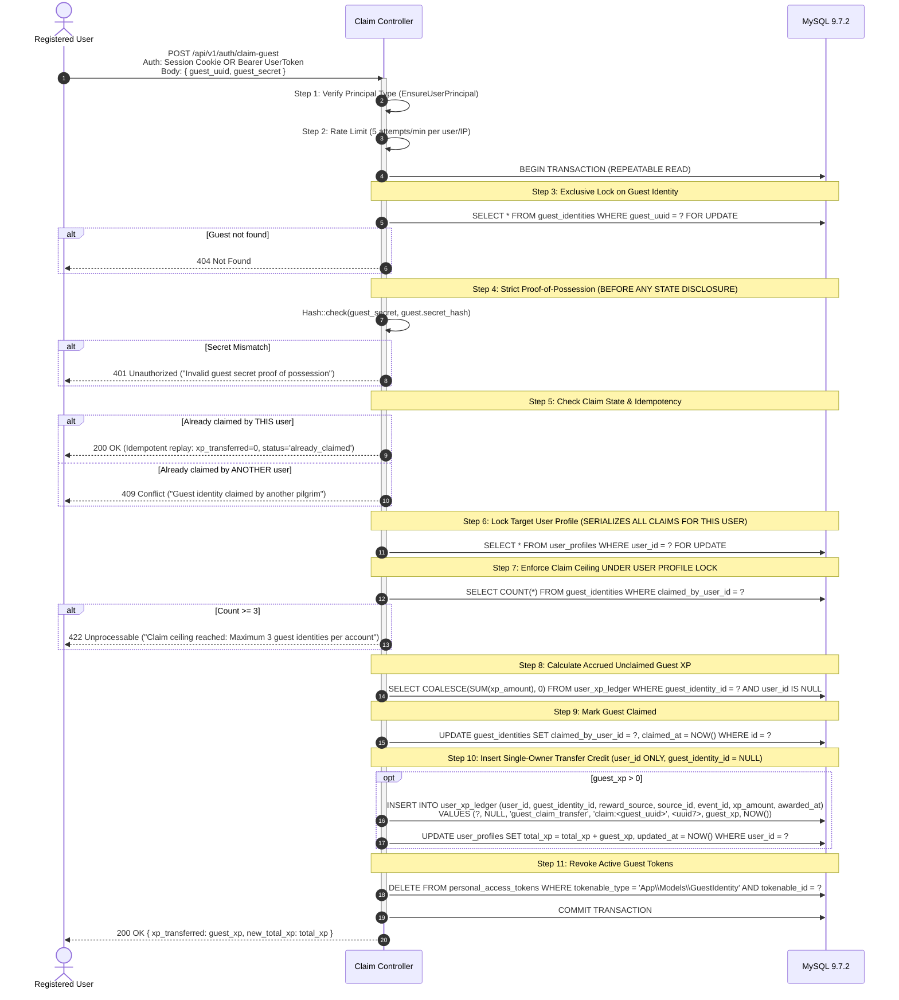

# Charyel — Phase 3C.2A: Authentication & Secure Guest Identity Architecture Design & Security Review (Revision 3)

**Author:** Antigravity Engineering
**Date:** October 16, 2026
**Revision:** 3.0.0-FINAL-RECONCILED
**Status:** Under Architectural Review (Design & Security Audit Only — Zero Code or Migration Changes)
**Target Platform:** Laravel 13 API (PHP 8.3+), Oracle MySQL 9.7.2 LTS, React 19 PWA (IndexedDB / Web Crypto)
**Relevant Schemas:**
- [0001_01_01_000000_create_users_table.php](file:///C:/laragon/www/charyel/server/database/migrations/0001_01_01_000000_create_users_table.php)
- [2026_10_16_000003_create_guest_identities_table.php](file:///C:/laragon/www/charyel/server/database/migrations/2026_10_16_000003_create_guest_identities_table.php)
- [2026_10_16_000004_create_user_profiles_and_memberships.php](file:///C:/laragon/www/charyel/server/database/migrations/2026_10_16_000004_create_user_profiles_and_memberships.php)
- [2026_10_16_000006_create_quiz_sessions_and_ledger.php](file:///C:/laragon/www/charyel/server/database/migrations/2026_10_16_000006_create_quiz_sessions_and_ledger.php)
- [2026_10_16_000007_create_processed_events_table.php](file:///C:/laragon/www/charyel/server/database/migrations/2026_10_16_000007_create_processed_events_table.php)
- [2026_10_16_000009_create_user_daily_competitive_counters.php](file:///C:/laragon/www/charyel/server/database/migrations/2026_10_16_000009_create_user_daily_competitive_counters.php)

---

## 1. Revision 3 Executive Summary & Reconciled Invariants

This revision resolves the final three architectural blockers identified in the Revision 2 audit:

| Dimension | Defect in Revision 2 | Reconciled Solution in Revision 3 |
| :--- | :--- | :--- |
| **A. Claim Ceiling Concurrency Race** | Claim count was checked before acquiring the lock on the target registered user's profile, allowing parallel claims to bypass the 3-guest limit. | **Strict Lock-Before-Count Sequence:** Target user profile row is locked `FOR UPDATE` *before* querying the current claim count. Parallel claiming requests targeting the same account are fully serialized. |
| **B. Late Offline Events Post-Claim** | Proved ambiguous by proposing direct conversion of late guest submissions into ordinary registered-user awards. | **Two-Phase Claim Lifecycle & Incremental Reconciliation:** Outbox is drained prior to claim finalization. Any late-arriving or replayed guest event preserves its historical guest attribution (`guest_identity_id`, `user_id = NULL`), while an incremental claim reconciliation credit is appended to the registered user's ledger without modifying past weekly competitive leaderboards. |
| **C. Sanctum Transport Differentiation** | Cookie-based SPA sessions and Bearer token responses were blurred together in API response schemas. | **Strictly Segregated Transport Modes:** Explicitly defines separate behaviors and response contracts for Browser PWA (Stateful HttpOnly Cookies with CSRF protection) vs Mobile/Service Worker Sync (Bearer Tokens) vs Guest Identity (Scoped 30-day Bearer Tokens). |

---

## 2. Final Product Decisions Confirmed

1. **Guest Token Lifetime:** Fixed **30-day expiration** from issuance. Silent re-authentication is performed by the PWA client using the persistent 256-bit `guest_secret` upon expiration.
2. **Guest Claim Ceiling:** Maximum **3 guest identities** claimed per registered account over its lifetime. Configurable via `config('charyel.auth.max_guest_claims')`. Exceptional adjustments require an audited administrative support procedure.
3. **Public Leaderboards:** **Registered users only** for initial public launch. Guests accumulate their own capped competitive XP ($C \le 400$) and lifetime progress, but remain excluded from public display until claimed.
4. **Authentication Framework:** Official **Laravel Sanctum** package (`laravel/sanctum`).
5. **Forward Migration Sequencing:**
   - **Migration 10:** Reserved for Laravel Sanctum's `personal_access_tokens` table.
   - **Migration 11:** Reserved for tightening `user_daily_competitive_counters` ownership constraints (strict XOR) and the typed `competitive_xp_events` audit table.
   - *Guardrail:* Migration 10 may be authored and tested on `charyel_schema_test` during Phase 3C.2B, but **must not be applied to `charyel_dev`** without explicit user approval.

---

## 3. Concurrency-Safe Guest Claiming Transaction Model

### 3.1 Deadlock-Free Canonical Locking Order
To prevent deadlocks in concurrent multi-account scenarios, all transactions acquire locks in strict canonical order:
1. **Resource 1:** `guest_identities` row (`WHERE guest_uuid = :guestUuid FOR UPDATE`)
2. **Resource 2:** `user_profiles` row (`WHERE user_id = :userId FOR UPDATE`)



### 3.2 Concurrency Proof: Two Guests Claiming Simultaneously at Limit
**Scenario:** A user account currently has **2 claimed guest identities**. The user (or an attacker) initiates two simultaneous requests:
- Request A: Claims Guest 1
- Request B: Claims Guest 2

**Execution Trace:**
1. Request A locks Guest 1 (`guest_identities`).
2. Request B locks Guest 2 (`guest_identities`).
3. Both evaluate `Hash::check()` successfully.
4. Request A reaches Step 6 and acquires the exclusive lock on User Profile X (`user_profiles WHERE user_id = X FOR UPDATE`).
5. Request B reaches Step 6 and requests an exclusive lock on User Profile X. **Request B blocks (waits for InnoDB row lock).**
6. Request A executes Step 7 under the profile lock: `SELECT COUNT(*) FROM guest_identities WHERE claimed_by_user_id = X` returns **2**. Limit is 3, so Request A proceeds.
7. Request A updates Guest 1 (`claimed_by_user_id = X`), appends the transfer row, commits the transaction, and releases the profile lock. Total claims in DB is now **3**.
8. Request B wakes up and acquires the lock on User Profile X.
9. Request B executes Step 7 under the profile lock: `SELECT COUNT(*) FROM guest_identities WHERE claimed_by_user_id = X` now returns **3**.
10. Step 7 evaluates: `3 >= 3`. Request B throws `ClaimCeilingExceededException` (HTTP 422).
11. Transaction B rolls back.
12. **Final State:** Exactly 3 claims exist. The ceiling invariant is mathematically preserved under arbitrary concurrency.

---

## 4. Offline Event Lifecycle & Incremental Reconciliation Protocol

### 4.1 Decoupling Account Registration from Progress Claiming
- An anonymous player may register an account or log in at any time, even if un-synced quiz sessions exist in the client IndexedDB outbox.
- Registration creates the `User` and `UserProfile` records. **Registration DOES NOT automatically claim the guest identity**.
- Guest claiming is an explicit two-phase workflow.

### 4.2 Two-Phase Claim Workflow
```
[Phase 1: Pre-Claim Outbox Drain]
  1. Client detects pending offline events in IndexedDB outbox.
  2. Client flushes all pending guest events to POST /api/v1/sync using guest credentials.
  3. Server validates events, attributes sessions to guest_identity_id, bounds competitive XP (<= 400 XP UTC), and writes rows to user_xp_ledger under principal_key = G:<guest_id>.
  4. Outbox reaches empty state.

[Phase 2: Claim Handshake]
  5. Client calls POST /api/v1/auth/claim-guest with user auth and { guest_uuid, guest_secret }.
  6. Server executes Section 3 atomic transaction.
  7. All accrued guest XP is summed and transferred via a single guest_claim_transfer row to U:<userId>.
  8. Client clears local guest credentials and binds active session to registered user.
```

### 4.3 Late-Arriving / Straggler Event Reconciliation Protocol
If a secondary device was offline during account claiming and reconnects days later with pending guest quiz sessions:

1. **Submission:** Device submits the offline session to `POST /api/v1/sync` presenting `{ guest_uuid, guest_secret, event_id, ... }`.
2. **Cryptographic Validation:** Server validates proof of possession against `guest_identities.secret_hash`.
3. **Claim Detection:** Server inspects the locked guest identity and detects `claimed_at IS NOT NULL`, resolving `$ownerUserId = $guest->claimed_by_user_id`.
4. **Historical Session Preservation:**
   - The session is inserted into `quiz_sessions` with:
     - `id = $sessionId`
     - `guest_identity_id = $guest->id`
     - `user_id = NULL` *(Original provenance strictly maintained!)*
     - `completed_at = $clientCompletedAt`
     - `synced_at = NOW()`
5. **Competitive Accounting Isolation:**
   - Server derives the UTC date of server receipt ($D$).
   - Competitive XP is evaluated against the guest daily counter for date $D$ (`G:<guest_id>`).
   - **Crucial Rule:** Zero competitive XP is added to the registered user's weekly leaderboard counter (`U:<ownerUserId>`).
6. **Incremental Claim Transfer Ledger Entry:**
   - The guest XP earned from this late session is credited to the guest in `user_xp_ledger` under `principal_key = G:<guest_id>`.
   - To reflect this late progress in the registered user's account without mutating past claim records, the server atomically appends an **incremental claim transfer** row:
     ```php
     DB::table('user_xp_ledger')->insert([
         'user_id' => $ownerUserId,
         'guest_identity_id' => null,
         'reward_source' => 'guest_claim_transfer',
         'source_id' => 'claim_reconcile:' . $eventId,
         'event_id' => (string) Str::uuid7(),
         'xp_amount' => $awardedGrossXp,
         'awarded_at' => now(),
     ]);

     DB::table('user_profiles')
         ->where('user_id', $ownerUserId)
         ->increment('total_xp', $awardedGrossXp);
     ```
7. **Replay & Idempotency:** The unique constraint on `(principal_key, reward_source, source_id)` in `user_xp_ledger` combined with `processed_events` ensures that replayed late sync packets are safely deduplicated.

---

## 5. Sanctum Authentication Transport Modes & Response Contracts

Charyel supports three distinct authentication profiles, each with its own transport headers, storage, and response schema:

| Dimension | Mode 1: Browser PWA Session | Mode 2: Mobile / Sync Bearer Token | Mode 3: Anonymous Guest Token |
| :--- | :--- | :--- | :--- |
| **Target Client** | First-party React 19 PWA in modern browsers. | Capacitor, React Native, or background sync workers. | Anonymous trivia players on any client. |
| **Transport** | `HttpOnly`, `Secure`, `SameSite=Lax` Cookie (`laravel_session`). | `Authorization: Bearer <plainTextToken>` | `Authorization: Bearer <plainTextToken>` |
| **CSRF Protection** | Required: `GET /sanctum/csrf-cookie` -> `X-XSRF-TOKEN` header on POST/PUT/DELETE. | Not required (Bearer tokens immune to ambient browser CSRF). | Not required (Bearer tokens immune to ambient browser CSRF). |
| **XSS Boundary** | Script cannot read `laravel_session` cookie; action execution still possible if XSS exists (mitigated via strict CSP). | Token stored in IndexedDB/SecureStore; accessible to same-origin scripts if XSS exists. | Secret and token stored in IndexedDB; accessible to same-origin scripts if XSS exists. |
| **Expiration** | Session lifetime (configurable, e.g. 14 days idle). | Long-lived or until explicit logout. | **Strict 30-day fixed expiry** from issuance. |
| **Revocation** | Invalidate session ID server-side (`Auth::logout()`). | Delete token row in `personal_access_tokens`. | Delete token row in `personal_access_tokens`. |
| **Principal Type** | `App\Models\User` | `App\Models\User` | `App\Models\GuestIdentity` |
| **Abilities** | Full session privileges (`user:all`). | Scoped or full (`['user:all']`). | Strict `['guest:play']`. |

---

### 5.1 Endpoint Contracts by Mode

#### A. Registered User Authentication (`POST /api/v1/auth/login` & `register`)

When requested by a **Browser PWA Client** (Cookie Mode, signaled by `X-Requested-With: XMLHttpRequest` or `Accept: application/json` with stateful Sanctum domain):
```json
{
  "status": "success",
  "data": {
    "auth_mode": "session",
    "user": {
      "id": 1,
      "name": "Jane Doe",
      "email": "jane@example.com"
    },
    "profile": {
      "pilgrim_name": "SisterJane",
      "total_xp": 0,
      "current_streak": 0
    },
    "church_membership": {
      "church_id": 3,
      "role": "pilgrim",
      "status": "active",
      "is_primary": true
    }
  }
}
```
*(No plainTextToken is returned in Cookie Mode; the `laravel_session` cookie is attached in the Set-Cookie response header).*

When requested by a **Mobile App / Bearer Client** (submitting `device_name`):
```json
{
  "status": "success",
  "data": {
    "auth_mode": "bearer",
    "token": "1|sanctum_plain_text_token...",
    "token_type": "Bearer",
    "abilities": ["user:all"],
    "user": { ... },
    "profile": { ... },
    "church_membership": { ... }
  }
}
```

#### B. Anonymous Guest Token Handshake (`POST /api/v1/auth/guest`)
Always returns a scoped Bearer token with a **30-day fixed expiration**:
```json
{
  "status": "success",
  "data": {
    "auth_mode": "bearer",
    "guest_uuid": "01929940-5f21-7000-8801-abcdef123456",
    "token": "2|sanctum_guest_token...",
    "token_type": "Bearer",
    "abilities": ["guest:play"],
    "expires_at": "2026-11-15T22:30:00Z",
    "is_claimed": false
  }
}
```

---

## 6. Comprehensive Test Matrix for Implementation Authorization

The following test suites must pass 100% on `charyel_schema_test` (MySQL 9.7.2) during Phase 3C.2B:

```
[Authentication & Transport Suite]
├── test_cookie_mode_login_authenticates_session_without_plain_text_token
├── test_bearer_mode_login_issues_valid_sanctum_token
├── test_registration_creates_profile_without_created_at_column
├── test_registration_creates_membership_without_default_timestamps
├── test_logout_invalidates_session_in_cookie_mode
├── test_logout_revokes_token_in_bearer_mode
└── test_ensure_user_principal_blocks_guest_token_from_user_routes

[Guest Identity & Silent Renewal Suite]
├── test_guest_registers_with_uuidv7_and_secret
├── test_guest_token_issued_with_thirty_day_fixed_expiry
├── test_expired_guest_token_can_silent_renew_with_valid_secret
├── test_guest_renewal_fails_with_401_on_invalid_secret
└── test_guest_token_has_strict_guest_play_ability

[Guest Claiming & Concurrency Invariant Suite]
├── test_claim_locks_guest_identity_and_user_profile_in_canonical_order
├── test_claim_fails_with_401_before_disclosing_state_on_bad_secret
├── test_claim_enforces_ceiling_of_three_guests_under_profile_lock
├── test_concurrent_claim_race_at_ceiling_allows_exactly_one_success_and_one_422
├── test_claim_creates_single_owner_ledger_entry_with_null_guest_id
├── test_claim_preserves_historical_quiz_sessions_with_guest_id_and_null_user_id
├── test_claim_atomically_increments_user_profile_total_xp
├── test_claim_is_idempotent_when_repeated_by_same_user
└── test_claim_rejects_with_409_when_attempted_by_different_user

[Late-Arriving Offline Event Reconciliation Suite]
├── test_pre_claim_outbox_drain_awards_xp_to_guest_before_claiming
├── test_late_event_arriving_post_claim_retains_historical_guest_session_attribution
├── test_late_event_arriving_post_claim_creates_incremental_claim_transfer_row
├── test_late_event_arriving_post_claim_increments_registered_user_profile_xp
├── test_late_event_arriving_post_claim_does_not_modify_user_weekly_competitive_counter
└── test_replayed_late_event_deduplicates_safely_via_processed_events
```

---

## 7. Precise Git & Repository Status Confirmation

In accordance with strict project reporting rules:
- **Git Branch:** `main` (synchronized with `origin/main` at commit `637d95a`).
- **Working Tree:** Contains **1 untracked documentation file**:
  `docs/architecture/charyel-phase-3c2a-auth-guest-identity-design.md`
  *No other files modified, 0 staged changes.*
- **Development Database (`charyel_dev`):** Unmodified (28 tables intact).
- **Production VPS (`192.210.241.55`):** Untouched and uncontacted.
- **Phase Status:** Phase 3C.2A Revision 3 completed. **Awaiting explicit user authorization before creating migrations, modifying composer, or writing application code.**
